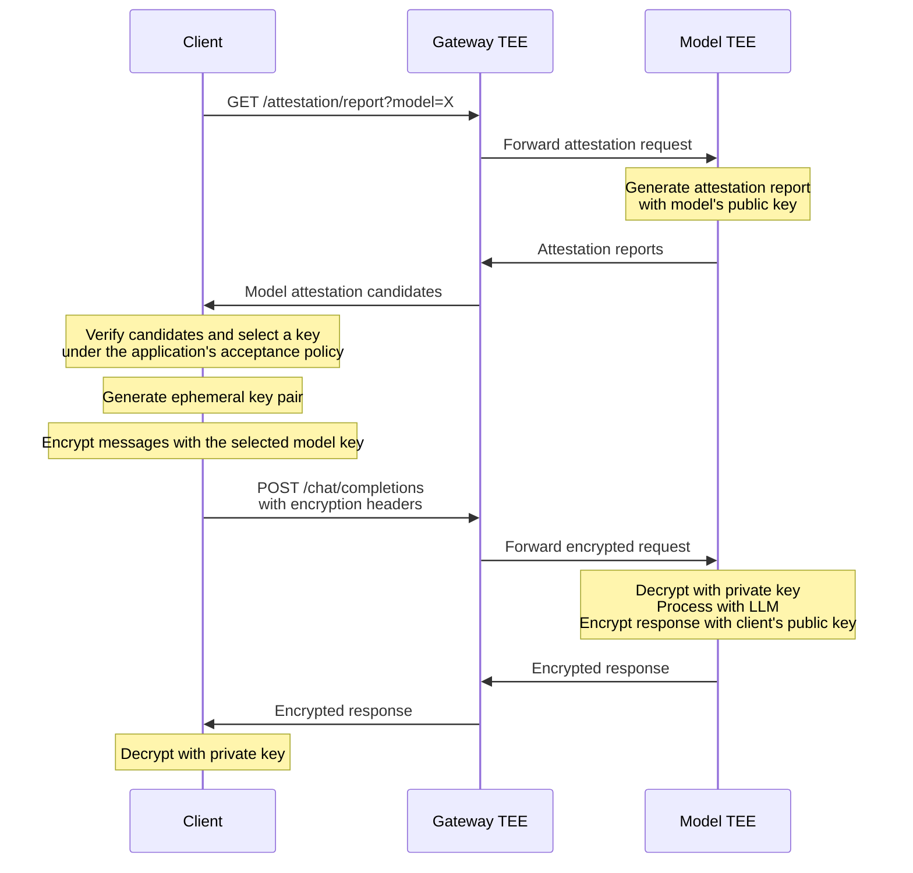

NEAR AI Cloud runs both the gateway and model inference inside Trusted Execution Environments (TEEs), providing strong hardware-level isolation. End-to-end encryption (E2EE) adds an additional layer of protection by encrypting your messages with the model's public key before they leave your machine.

This guide uses the NEAR model E2EE protocol. The gateway sends client-E2EE requests only to a compatible NEAR-serving path; if none is available, the request is unsupported rather than routed through a different E2EE protocol.

## Why Use E2EE?

With E2EE enabled, your messages are encrypted client-side using the model's public key, which is cryptographically bound to its TEE attestation. This provides:

- **Defense in depth** — Multiple independent encryption layers on top of TLS
- **Model-specific encryption** — Only model environments holding the attested model key can decrypt your messages
- **Cryptographic binding** — Messages are tied to a verified TEE through attestation
- **Reply-key binding** — Each encrypted request field authenticates the public key that will receive the reply

### Via Gateway



---

## Encryption Protocol

SDK 0.3.0 uses version 3 for both signing algorithms. The client generates a fresh reply key pair for each request. When encrypting each field, it supplies the reply public key and the field's protocol label as additional authenticated data (AAD). The model proxy checks both before processing the field.

| Signing algorithm | Suite ID | Reply public key used in AAD | Key exchange and encryption |
| --- | --- | --- | --- |
| Ed25519 (SDK default) | `0x02` | 32-byte Ed25519 key | X25519 ECDH, HKDF-SHA256, XChaCha20-Poly1305 |
| ECDSA | `0x01` | 65-byte uncompressed key including its `0x04` prefix | secp256k1 ECDH, HKDF-SHA256, AES-256-GCM |

To build the request AAD, concatenate these bytes in order.

```text
UTF8("nearai-e2ee-request-v3") || suite_id || reply_public_key || 0x00 || UTF8(field_label)
```

Use the literal label `messages[].content` for every message position. Response fields use the validated reply key and empty AAD. See the [wire protocol](https://github.com/nearai/inference-proxy/blob/97b1203e529cad97ba7289f2592a0b63dc41f26f/docs/e2ee.md#version-3) for all field labels and ciphertext formats.

## Quick Start

Enable E2EE on the Chat Completions client. It verifies the model key, encrypts the request, and decrypts the reply. The example checks the reply signature before printing the answer. Install the [Python SDK](/cloud/inference-sdk/python#install) and set `NEARAI_API_KEY`.

```python
import asyncio
import os

from nearai_inference_sdk import InferenceClient


async def main():
    async with InferenceClient(os.environ["NEARAI_API_KEY"], e2ee=True) as client:
        completion = await client.chat.completions.create(
            model="z-ai/glm-5.3-flash",
            messages=[{"role": "user", "content": "What is the capital of France?"}],
        )
        receipt = await client.verify_response(completion.id)
        if receipt.signature_kind != "provider_tee":
            raise RuntimeError("Expected a model-signed reply.")
        print(completion.choices[0].message.content)


asyncio.run(main())
```

## Step-by-Step Guide

Use the [Python SDK](/cloud/inference-sdk/python#install) with `requests`, `PyNaCl`, and `cryptography`, or the [Node.js SDK](/cloud/inference-sdk/javascript#install) with `@noble/curves@1`, `@noble/hashes@1`, and `@noble/ciphers@1`.

### Step 1: Get the Model's Public Key

The SDK fetches fresh attestation evidence, checks the nonce on each report, and returns the verified model reports. Select an Ed25519 public key from those reports. You will encrypt the prompt to this key and send it in `X-Model-Pub-Key` to route the request. This public model can be verified without an API key.

<Tabs>
<Tab title="Python">

```python
import asyncio
from nearai_inference_sdk import InferenceClient

model = "z-ai/glm-5.3-flash"

async def verified_model_key(model):
    async with InferenceClient() as client:
        evidence = await client.verify(model)
    for report in evidence.models:
        if report.signer.signing_algo == "ed25519" and report.signing_public_key:
            return report.signing_public_key
    raise ValueError("No verified Ed25519 model key")

model_public_key_hex = asyncio.run(verified_model_key(model))
```

</Tab>
<Tab title="JavaScript">

```javascript
import { InferenceClient } from '@nearai/inference-sdk/node';
import { randomBytes } from 'node:crypto';

const model = 'z-ai/glm-5.3-flash';
const client = new InferenceClient();
const { models } = await client.verify(model);
const modelPublicKeyHex = models.find(
  (report) => report.signer.signingAlgo === 'ed25519' && report.signingPublicKey
)?.signingPublicKey;
if (!modelPublicKeyHex) throw new Error('No verified Ed25519 model key');
```

</Tab>
<Tab title="curl (raw report)">

Generate a fresh nonce and fetch the candidates. Follow [NEAR model attestation](/cloud/verification/cloud-api/model-attestations) to verify every report against this nonce before selecting its signing public key.

```bash
NONCE="$(openssl rand -hex 32)"

curl --fail-with-body -G 'https://cloud-api.near.ai/v1/attestation/report' \
  --data-urlencode 'model=z-ai/glm-5.3-flash' \
  --data-urlencode 'provider=near' \
  --data-urlencode 'signing_algo=ed25519' \
  --data-urlencode 'include_tls_fingerprint=false' \
  --data-urlencode "nonce=${NONCE}" \
  -H 'x-no-aliasing: true'
```

</Tab>
</Tabs>

---

### Step 2: Generate Client Key Pair

Generate a fresh Ed25519 key pair for this request. Use the public key for the request AAD and the private key to decrypt the response.

<Tabs>
<Tab title="Python">

```python
from nacl.signing import SigningKey
from nacl.bindings import crypto_sign_ed25519_sk_to_curve25519

# Generate Ed25519 key pair
client_signing_key = SigningKey.generate()
client_public_key_hex = bytes(client_signing_key.verify_key).hex()

# Derive X25519 secret key (needed for decryption later)
client_x25519_secret = crypto_sign_ed25519_sk_to_curve25519(
    bytes(client_signing_key) + bytes(client_signing_key.verify_key)
)

print(f"Client public key: {client_public_key_hex}")
```

</Tab>
<Tab title="JavaScript">

```javascript
import { ed25519 } from '@noble/curves/ed25519';

// Generate Ed25519 key pair
const privateKeyBytes = randomBytes(32);
const publicKeyBytes = ed25519.getPublicKey(privateKeyBytes);
const clientPublicKeyHex = Buffer.from(publicKeyBytes).toString('hex');
const clientX25519Secret = ed25519.utils.toMontgomerySecret(privateKeyBytes);

console.log('Client public key:', clientPublicKeyHex);
```

</Tab>
</Tabs>

---

### Step 3: Encrypt Your Messages

Encrypt message content using the model's public key. The protocol uses X25519 ECDH key exchange, HKDF-SHA256 key derivation, and XChaCha20-Poly1305 symmetric encryption.

<Tabs>
<Tab title="Python">

```python
import secrets
from nacl.bindings import (
    crypto_sign_ed25519_pk_to_curve25519,
    crypto_aead_xchacha20poly1305_ietf_encrypt,
    crypto_aead_xchacha20poly1305_ietf_NPUBBYTES,
)
from cryptography.hazmat.primitives.asymmetric.x25519 import X25519PrivateKey, X25519PublicKey
from cryptography.hazmat.primitives.kdf.hkdf import HKDF
from cryptography.hazmat.primitives import hashes

def encrypt_for_model(plaintext: str, model_ed25519_pub_hex: str, reply_key_hex: str, field: str) -> str:
    """Encrypt using X25519 ECDH + HKDF-SHA256 + XChaCha20-Poly1305."""
    # Convert model's Ed25519 public key to X25519
    model_ed25519_pub = bytes.fromhex(model_ed25519_pub_hex)
    model_x25519_pub = crypto_sign_ed25519_pk_to_curve25519(model_ed25519_pub)

    # Generate ephemeral X25519 key pair
    ephemeral_private = X25519PrivateKey.generate()
    ephemeral_public = ephemeral_private.public_key()

    # X25519 ECDH key exchange
    shared_secret = ephemeral_private.exchange(
        X25519PublicKey.from_public_bytes(model_x25519_pub)
    )

    # Derive symmetric key with HKDF-SHA256
    symmetric_key = HKDF(
        algorithm=hashes.SHA256(),
        length=32,
        salt=None,
        info=b"ed25519_encryption",
    ).derive(shared_secret)

    # Encrypt with XChaCha20-Poly1305 (24-byte nonce)
    nonce = secrets.token_bytes(crypto_aead_xchacha20poly1305_ietf_NPUBBYTES)
    aad = b"nearai-e2ee-request-v3\x02" + bytes.fromhex(reply_key_hex) + b"\x00" + field.encode("ascii")
    ciphertext = crypto_aead_xchacha20poly1305_ietf_encrypt(
        plaintext.encode(), aad, nonce, symmetric_key
    )

    # Wire format: [ephemeral_pubkey (32 bytes)][nonce (24 bytes)][ciphertext + tag]
    encrypted = ephemeral_public.public_bytes_raw() + nonce + ciphertext
    return encrypted.hex()

# Encrypt your message
encrypted_content = encrypt_for_model(
    "What is the capital of France?",
    model_public_key_hex, client_public_key_hex, "messages[].content"
)
```

</Tab>
<Tab title="JavaScript">

```javascript
import { x25519, edwardsToMontgomeryPub } from '@noble/curves/ed25519';
import { hkdf } from '@noble/hashes/hkdf';
import { sha256 } from '@noble/hashes/sha256';
import { xchacha20poly1305 } from '@noble/ciphers/chacha';

function encryptForModel(plaintext, modelEd25519PubHex, replyKeyHex, field) {
  // Convert model's Ed25519 public key to X25519
  const modelEd25519Pub = Buffer.from(modelEd25519PubHex, 'hex');
  const modelX25519Pub = edwardsToMontgomeryPub(modelEd25519Pub);

  // Generate ephemeral X25519 key pair
  const ephemeralPrivate = randomBytes(32);
  const ephemeralPublic = x25519.getPublicKey(ephemeralPrivate);

  // X25519 ECDH key exchange
  const sharedSecret = x25519.getSharedSecret(ephemeralPrivate, modelX25519Pub);

  // Derive symmetric key with HKDF-SHA256
  const symmetricKey = hkdf(sha256, sharedSecret, undefined, 'ed25519_encryption', 32);

  // Encrypt with XChaCha20-Poly1305 (24-byte nonce)
  const nonce = randomBytes(24);
  const aad = Buffer.concat([
    Buffer.from('nearai-e2ee-request-v3'), Buffer.from([0x02]),
    Buffer.from(replyKeyHex, 'hex'), Buffer.from([0]), Buffer.from(field, 'ascii'),
  ]);
  const cipher = xchacha20poly1305(symmetricKey, nonce, aad);
  const ciphertext = cipher.encrypt(new TextEncoder().encode(plaintext));

  // Wire format: [ephemeral_pubkey (32)][nonce (24)][ciphertext + tag]
  return Buffer.concat([
    Buffer.from(ephemeralPublic),
    nonce,
    Buffer.from(ciphertext)
  ]).toString('hex');
}

const encryptedContent = encryptForModel(
  'What is the capital of France?',
  modelPublicKeyHex, clientPublicKeyHex, 'messages[].content'
);
```

</Tab>
</Tabs>

---

### Step 4: Make the Encrypted Request

Send the ciphertext and both public keys. The model decrypts the prompt and encrypts its reply to your public key. These HTTP examples use standard HTTPS. The [SDK quick start](#quick-start) also pins the inference connection to the attested Gateway key.

<Tabs>
<Tab title="curl (Gateway)">

```bash
curl https://cloud-api.near.ai/v1/chat/completions \
  -H "Content-Type: application/json" \
  -H "Authorization: Bearer YOUR_API_KEY" \
  -H "X-Signing-Algo: ed25519" \
  -H "X-Client-Pub-Key: YOUR_ED25519_PUBLIC_KEY_HEX" \
  -H "X-Model-Pub-Key: MODEL_ED25519_PUBLIC_KEY_HEX" \
  -H "X-Encryption-Version: 3" \
  -H "x-no-aliasing: true" \
  -d '{
    "model": "z-ai/glm-5.3-flash",
    "messages": [{
      "role": "user",
      "content": "ENCRYPTED_CONTENT_HEX"
    }],
    "stream": false
  }'
```

</Tab>
<Tab title="Python">

```python
import os
import requests

api_key = os.environ["NEARAI_API_KEY"]
response = requests.post(
    "https://cloud-api.near.ai/v1/chat/completions",
    headers={
        "Authorization": f"Bearer {api_key}",
        "Content-Type": "application/json",
        "X-Signing-Algo": "ed25519",
        "X-Client-Pub-Key": client_public_key_hex,
        "X-Model-Pub-Key": model_public_key_hex,
        "X-Encryption-Version": "3",
        "x-no-aliasing": "true",
    },
    json={
        "model": model,
        "messages": [{
            "role": "user",
            "content": encrypted_content  # Hex-encoded encrypted message
        }],
        "stream": False,
    },
)
response.raise_for_status()
data = response.json()
```

</Tab>
<Tab title="JavaScript">

```javascript
const apiKey = process.env.NEARAI_API_KEY;
const chatResponse = await fetch('https://cloud-api.near.ai/v1/chat/completions', {
  method: 'POST',
  headers: {
    'Authorization': `Bearer ${apiKey}`,
    'Content-Type': 'application/json',
    'X-Signing-Algo': 'ed25519',
    'X-Client-Pub-Key': clientPublicKeyHex,
    'X-Model-Pub-Key': modelPublicKeyHex,
    'X-Encryption-Version': '3',
    'x-no-aliasing': 'true',
  },
  body: JSON.stringify({
    model,
    messages: [{
      role: 'user',
      content: encryptedContent
    }],
    stream: false
  })
});

if (!chatResponse.ok) throw new Error(`Chat request failed: ${chatResponse.status}`);
const data = await chatResponse.json();
```

</Tab>
</Tabs>

#### Required Headers

| Header | Description |
|--------|-------------|
| `X-Signing-Algo` | Set to `ed25519` |
| `X-Client-Pub-Key` | Your Ed25519 public key in hex format (32 bytes / 64 hex chars) |
| `X-Encryption-Version` | Set to `3` |
| `X-Model-Pub-Key` | Ed25519 public key from the selected, verified model report; required as the gateway routing pin |
| `x-no-aliasing` | Set to `true` for gateway requests so the model ID and attested model key cannot be silently redirected. |

SDK 0.3.0 also sends `X-Encrypt-All-Fields: true`. In manual v3 requests this header is optional. Encrypt all supported [function and tool fields](#encrypting-all-fields-tool-calling) whenever they appear.

---

### Step 5: Decrypt the Response

The response `content`, `reasoning_content`, and `reasoning` fields can contain hex-encoded encrypted data. Decrypt each populated field with the request’s reply private key and empty AAD.

<Tabs>
<Tab title="Python">

```python
from nacl.bindings import (
    crypto_sign_ed25519_sk_to_curve25519,
    crypto_aead_xchacha20poly1305_ietf_decrypt,
)
from cryptography.hazmat.primitives.asymmetric.x25519 import X25519PrivateKey, X25519PublicKey
from cryptography.hazmat.primitives.kdf.hkdf import HKDF
from cryptography.hazmat.primitives import hashes

def decrypt_response(encrypted_hex: str, client_x25519_secret: bytes) -> str:
    """Decrypt a response using your X25519 secret key."""
    data = bytes.fromhex(encrypted_hex)

    # Parse wire format: [ephemeral_pubkey (32)][nonce (24)][ciphertext + tag]
    ephemeral_pub = X25519PublicKey.from_public_bytes(data[:32])
    nonce = data[32:56]
    ciphertext = data[56:]

    # X25519 ECDH with the ephemeral public key from the response
    client_private = X25519PrivateKey.from_private_bytes(client_x25519_secret)
    shared_secret = client_private.exchange(ephemeral_pub)

    # Derive symmetric key with HKDF-SHA256
    symmetric_key = HKDF(
        algorithm=hashes.SHA256(),
        length=32,
        salt=None,
        info=b"ed25519_encryption",
    ).derive(shared_secret)

    # Decrypt with XChaCha20-Poly1305
    plaintext = crypto_aead_xchacha20poly1305_ietf_decrypt(
        ciphertext, None, nonce, symmetric_key
    )
    return plaintext.decode("utf-8")

# Decrypt response fields
msg = data["choices"][0]["message"]

if msg.get("content"):
    print("Content:", decrypt_response(msg["content"], client_x25519_secret))

if msg.get("reasoning_content"):
    print("Reasoning:", decrypt_response(msg["reasoning_content"], client_x25519_secret))

if msg.get("reasoning"):
    print("Reasoning:", decrypt_response(msg["reasoning"], client_x25519_secret))
```

</Tab>
<Tab title="JavaScript">

```javascript
function decryptResponse(encryptedHex, clientX25519Secret) {
  const data = Buffer.from(encryptedHex, 'hex');

  // Parse wire format: [ephemeral_pubkey (32)][nonce (24)][ciphertext + tag]
  const ephemeralPub = data.slice(0, 32);
  const nonce = data.slice(32, 56);
  const ciphertext = data.slice(56);

  // X25519 ECDH with the ephemeral public key from the response
  const sharedSecret = x25519.getSharedSecret(clientX25519Secret, ephemeralPub);

  // Derive symmetric key with HKDF-SHA256
  const symmetricKey = hkdf(sha256, sharedSecret, undefined, 'ed25519_encryption', 32);

  // Decrypt with XChaCha20-Poly1305
  const decipher = xchacha20poly1305(symmetricKey, nonce);
  const plaintext = decipher.decrypt(ciphertext);

  return new TextDecoder().decode(plaintext);
}

// Decrypt response fields
const msg = data.choices[0].message;

if (msg.content) {
  console.log('Content:', decryptResponse(msg.content, clientX25519Secret));
}
if (msg.reasoning_content) {
  console.log('Reasoning:', decryptResponse(msg.reasoning_content, clientX25519Secret));
}
if (msg.reasoning) {
  console.log('Reasoning:', decryptResponse(msg.reasoning, clientX25519Secret));
}
```

</Tab>
</Tabs>

---

## Encrypting All Fields (Tool Calling)

Version 3 encrypts supported function and tool fields whenever they appear. Serialize a tool's parameter schema or a multimodal content array to JSON before encrypting it as one field.

| Direction | Protected examples |
| --- | --- |
| Request | Function names, descriptions and parameter schemas in tool definitions, named tool choices, and function names and arguments in message tool calls |
| Response | Function names and arguments, refusal, tool results, and logprob tokens and bytes |

For a manual request, use the Ed25519 helper from [Step 3](#step-3-encrypt-your-messages). Add this tool to the request from [Step 4](#step-4-make-the-encrypted-request) using the same fresh reply key as its prompt.

```python
import json

def encrypt_tool_field(value, field):
    return encrypt_for_model(value, model_public_key_hex, client_public_key_hex, field)

schema = {"type": "object", "properties": {"city": {"type": "string"}}, "required": ["city"]}
tool = {
    "type": "function",
    "function": {
        "name": encrypt_tool_field("get_weather", "tools[].function.name"),
        "description": encrypt_tool_field("Get the weather in a city", "tools[].function.description"),
        "parameters": encrypt_tool_field(json.dumps(schema), "tools[].function.parameters"),
    },
}
```

After decrypting a tool call, encrypt its name and arguments again with the next request's reply key and the message labels `messages[].tool_calls[].function.name` and `messages[].tool_calls[].function.arguments`. Use `messages[].content` for the tool result you send back.

## Important Notes

### Supported Endpoints

The Inference SDK supports field-level E2EE for `POST /v1/chat/completions`. For raw HTTP clients, the [proxy protocol](https://github.com/nearai/inference-proxy/blob/97b1203e529cad97ba7289f2592a0b63dc41f26f/docs/e2ee.md#field-policy) documents support for additional endpoints. Both the Gateway and the model endpoint must support v3.

### Message Format

- Encrypted message content must be hex-encoded
- The `content`, `reasoning_content`, and `reasoning` fields in responses can be hex-encoded encrypted data
- Each streaming chunk's content is independently encrypted

### Verification

Before using a model public key for encryption, verify the attestation report and its fresh client nonce against hardware attestation. For a gateway response, verify every returned model-attestation candidate and choose a key only from reports accepted by your policy. See [Verification](/cloud/verification) for the Gateway verification flow.

---

## ECDSA Encryption

<Accordion title="Use secp256k1 ECDH, HKDF-SHA256, and AES-256-GCM with E2EE v3">
  ### Get the Model's ECDSA Public Key

  Verify every returned model-attestation candidate and its fresh nonce before applying your acceptance policy and using a selected public key, as described in [NEAR model attestations](/cloud/verification/cloud-api/model-attestations).

  ```bash
  NONCE="$(openssl rand -hex 32)"

  curl --fail-with-body -G 'https://cloud-api.near.ai/v1/attestation/report' \
    --data-urlencode 'model=z-ai/glm-5.3-flash' \
    --data-urlencode 'provider=near' \
    --data-urlencode 'signing_algo=ecdsa' \
    --data-urlencode 'include_tls_fingerprint=false' \
    --data-urlencode "nonce=${NONCE}" \
    -H 'x-no-aliasing: true'
  ```

  ### Generate ECDSA Client Key Pair

  ```python
  from cryptography.hazmat.primitives.asymmetric import ec
  from cryptography.hazmat.primitives import serialization
  from cryptography.hazmat.backends import default_backend

  private_key = ec.generate_private_key(ec.SECP256K1(), default_backend())
  public_key = private_key.public_key()

  public_key_bytes = public_key.public_bytes(
      encoding=serialization.Encoding.X962,
      format=serialization.PublicFormat.UncompressedPoint
  )
  client_public_key_hex = public_key_bytes.hex()
  ```

  ### Encrypt with ECDSA

  ```python
  import os
  from cryptography.hazmat.primitives import hashes, serialization
  from cryptography.hazmat.primitives.asymmetric import ec
  from cryptography.hazmat.primitives.ciphers.aead import AESGCM
  from cryptography.hazmat.primitives.kdf.hkdf import HKDF
  from cryptography.hazmat.backends import default_backend

  def encrypt_for_model_ecdsa(plaintext: str, model_public_key_hex: str, reply_key_hex: str, field: str) -> str:
      public_key_bytes = bytes.fromhex(model_public_key_hex)
      if len(public_key_bytes) == 64:
          public_key_bytes = b'\x04' + public_key_bytes

      model_public_key = ec.EllipticCurvePublicKey.from_encoded_point(
          ec.SECP256K1(), public_key_bytes
      )

      ephemeral_private = ec.generate_private_key(ec.SECP256K1(), default_backend())
      ephemeral_public = ephemeral_private.public_key()
      shared_secret = ephemeral_private.exchange(ec.ECDH(), model_public_key)

      aes_key = HKDF(
          algorithm=hashes.SHA256(), length=32,
          salt=None, info=b"ecdsa_encryption", backend=default_backend()
      ).derive(shared_secret)

      nonce = os.urandom(12)
      reply_key = bytes.fromhex(reply_key_hex)
      if len(reply_key) == 64:
          reply_key = b'\x04' + reply_key
      aad = b"nearai-e2ee-request-v3\x01" + reply_key + b"\x00" + field.encode("ascii")
      ciphertext = AESGCM(aes_key).encrypt(nonce, plaintext.encode(), aad)

      # Format: [ephemeral_public (65 bytes)][nonce (12 bytes)][ciphertext]
      ephemeral_public_bytes = ephemeral_public.public_bytes(
          encoding=serialization.Encoding.X962,
          format=serialization.PublicFormat.UncompressedPoint
      )
      return (ephemeral_public_bytes + nonce + ciphertext).hex()
  ```

  Encrypt message content with `encrypt_for_model_ecdsa(text, model_public_key_hex, client_public_key_hex, "messages[].content")`.

  ### Send ECDSA Encrypted Request

  ```bash
  curl https://cloud-api.near.ai/v1/chat/completions \
    -H "Content-Type: application/json" \
    -H "Authorization: Bearer YOUR_API_KEY" \
    -H "X-Signing-Algo: ecdsa" \
    -H "X-Encryption-Version: 3" \
    -H "X-Client-Pub-Key: YOUR_ECDSA_PUBLIC_KEY_HEX" \
    -H "X-Model-Pub-Key: MODEL_ECDSA_PUBLIC_KEY_HEX" \
    -H "x-no-aliasing: true" \
    -d '{
      "model": "z-ai/glm-5.3-flash",
      "messages": [{"role": "user", "content": "ENCRYPTED_CONTENT_HEX"}],
      "stream": false
    }'
  ```

  ### Decrypt ECDSA Response

  ```python
  from cryptography.hazmat.primitives import hashes
  from cryptography.hazmat.primitives.asymmetric import ec
  from cryptography.hazmat.primitives.ciphers.aead import AESGCM
  from cryptography.hazmat.primitives.kdf.hkdf import HKDF
  from cryptography.hazmat.backends import default_backend

  def decrypt_response_ecdsa(encrypted_hex: str, private_key) -> str:
      encrypted_data = bytes.fromhex(encrypted_hex)

      ephemeral_public = ec.EllipticCurvePublicKey.from_encoded_point(
          ec.SECP256K1(), encrypted_data[:65]
      )
      nonce = encrypted_data[65:77]
      ciphertext = encrypted_data[77:]

      shared_secret = private_key.exchange(ec.ECDH(), ephemeral_public)
      aes_key = HKDF(
          algorithm=hashes.SHA256(), length=32,
          salt=None, info=b"ecdsa_encryption", backend=default_backend()
      ).derive(shared_secret)

      return AESGCM(aes_key).decrypt(nonce, ciphertext, None).decode()
  ```
</Accordion>

---

## See Also

- [Private Inference](/cloud/private-inference) — How TEE isolation protects your data
- [Verification](/cloud/verification) — Verify NEAR AI Cloud Gateway requests
- [Verification Policy](/cloud/verification/reference/verification-policy) — Define the evidence your application requires
