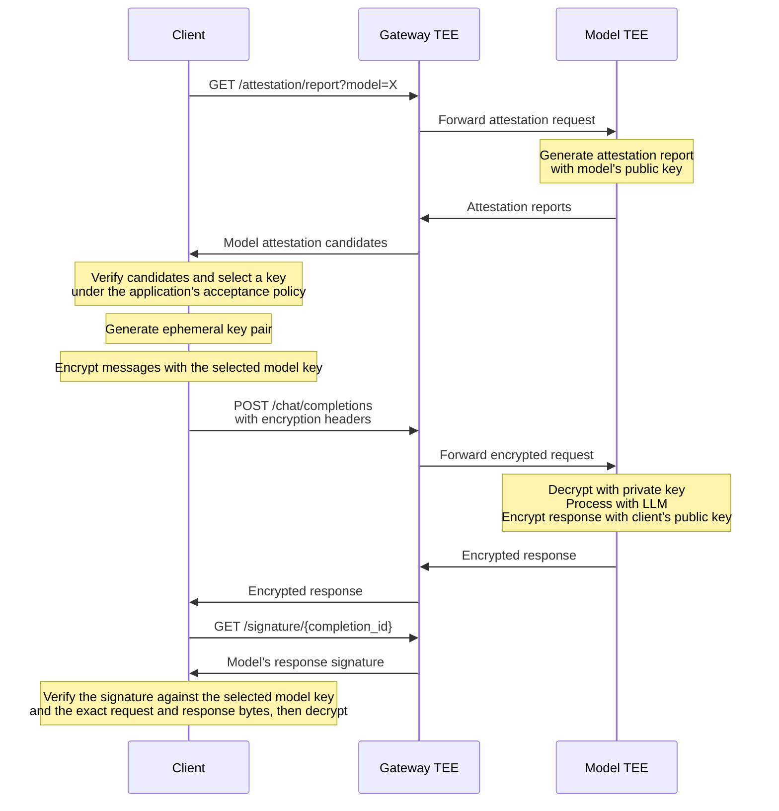

For models that support end-to-end encryption (E2EE), your client encrypts messages with the model's attested public key before sending them through the Gateway.

This guide uses the NEAR model E2EE protocol. The gateway sends client-E2EE requests only to a compatible NEAR-serving path; if none is available, the request is unsupported rather than routed through a different E2EE protocol.

## Why Use E2EE?

With E2EE enabled, your messages are encrypted client-side using the model's public key, which is cryptographically bound to its TEE attestation. This provides:

- **Defense in depth** — Multiple independent encryption layers on top of TLS
- **Model-specific encryption** — Only model environments holding the attested model key can decrypt your messages
- **Cryptographic binding** — Messages are tied to a verified TEE through attestation
- **Reply-key binding** — Each encrypted request field authenticates the public key that will receive the reply

### Via Gateway



---

## Encryption Protocol

The SDK uses E2EE protocol v3 for both Ed25519 and ECDSA. The client generates a fresh reply key pair for each request. When encrypting each field, it supplies the reply public key and the field's protocol label as additional authenticated data (AAD). The model proxy checks both before processing the field.

| Signing algorithm | Suite ID | Reply public key used in AAD | Key exchange and encryption |
| --- | --- | --- | --- |
| Ed25519 (SDK default) | `0x02` | 32-byte Ed25519 key | X25519 ECDH, HKDF-SHA256, XChaCha20-Poly1305 |
| ECDSA | `0x01` | 65-byte uncompressed key including its `0x04` prefix | secp256k1 ECDH, HKDF-SHA256, AES-256-GCM |

To build the request AAD, concatenate these bytes in order.

```text
UTF8("nearai-e2ee-request-v3") || suite_id || reply_public_key || 0x00 || UTF8(field_label)
```

Use the literal label `messages[].content` for every message position. Response fields use the validated reply key and empty AAD. See the [wire protocol](https://github.com/nearai/inference-proxy/blob/97b1203e529cad97ba7289f2592a0b63dc41f26f/docs/e2ee.md#version-3) for all field labels and ciphertext formats.

## Quick Start

Set `e2ee: true` on the [JavaScript client](/cloud/inference-sdk/javascript). It verifies the model key, encrypts the request, and decrypts the reply. Verify the response signature before using the answer.

```javascript
import { InferenceClient } from '@nearai/inference-sdk/node';

const apiKey = process.env.NEARAI_API_KEY;
if (!apiKey) throw new Error('NEARAI_API_KEY is required');

const client = new InferenceClient({ apiKey, e2ee: true });
const completion = await client.chat.completions.create({
  model: 'z-ai/glm-5.3-flash',
  messages: [{ role: 'user', content: 'What is the capital of France?' }],
});

const receipt = await client.verifyResponse(completion.id);
if (receipt.signatureKind !== 'provider_tee') {
  throw new Error('Expected a model-signed reply.');
}
console.log(completion.choices[0]?.message.content);
```

The [Python](/cloud/inference-sdk/python#e2ee), [Rust](/cloud/inference-sdk/rust#e2ee), and [Go](/cloud/inference-sdk/go#e2ee) SDKs also support this flow.

## Step-by-Step Guide

### Step 1: Get the Model's Public Key

The SDK fetches fresh attestation evidence, checks the nonce on each report, and returns the verified model reports. Select an Ed25519 public key from those reports. You will encrypt the prompt to this key and send it in `X-Model-Pub-Key` to route the request. This public model can be verified without an API key.

```javascript
import { AttestationClient, InferenceClient, verifyModelResponse } from '@nearai/inference-sdk/node';
import { randomBytes } from 'node:crypto';

const model = 'z-ai/glm-5.3-flash';
const client = new InferenceClient();
const { models } = await client.verify(model);
const modelAttestation = models.find(
  (report) => report.signer.signingAlgo === 'ed25519' && report.signingPublicKey
);
if (!modelAttestation) throw new Error('No verified Ed25519 model key');
const modelPublicKeyHex = modelAttestation.signingPublicKey;
```

---

### Step 2: Generate Client Key Pair

Generate a fresh Ed25519 key pair for this request. Use the public key for the request AAD and the private key to decrypt the response.

```javascript
import { ed25519 } from '@noble/curves/ed25519.js';

// Generate Ed25519 key pair
const privateKeyBytes = randomBytes(32);
const publicKeyBytes = ed25519.getPublicKey(privateKeyBytes);
const clientPublicKeyHex = Buffer.from(publicKeyBytes).toString('hex');
const clientX25519Secret = ed25519.utils.toMontgomerySecret(privateKeyBytes);

console.log('Client public key:', clientPublicKeyHex);
```

---

### Step 3: Encrypt Your Messages

Encrypt message content using the model's public key. The protocol uses X25519 ECDH key exchange, HKDF-SHA256 key derivation, and XChaCha20-Poly1305 symmetric encryption.

```javascript
import { x25519 } from '@noble/curves/ed25519.js';
import { hkdf } from '@noble/hashes/hkdf.js';
import { sha256 } from '@noble/hashes/sha2.js';
import { xchacha20poly1305 } from '@noble/ciphers/chacha.js';

function encryptForModel(plaintext, modelEd25519PubHex, replyKeyHex, field) {
  // Convert model's Ed25519 public key to X25519
  const modelEd25519Pub = Buffer.from(modelEd25519PubHex, 'hex');
  const modelX25519Pub = ed25519.utils.toMontgomery(modelEd25519Pub);

  // Generate ephemeral X25519 key pair
  const ephemeralPrivate = randomBytes(32);
  const ephemeralPublic = x25519.getPublicKey(ephemeralPrivate);

  // X25519 ECDH key exchange
  const sharedSecret = x25519.getSharedSecret(ephemeralPrivate, modelX25519Pub);

  // Derive symmetric key with HKDF-SHA256
  const symmetricKey = hkdf(sha256, sharedSecret, undefined, Buffer.from('ed25519_encryption'), 32);

  // Encrypt with XChaCha20-Poly1305 (24-byte nonce)
  const nonce = randomBytes(24);
  const aad = Buffer.concat([
    Buffer.from('nearai-e2ee-request-v3'), Buffer.from([0x02]),
    Buffer.from(replyKeyHex, 'hex'), Buffer.from([0]), Buffer.from(field, 'ascii'),
  ]);
  const cipher = xchacha20poly1305(symmetricKey, nonce, aad);
  const ciphertext = cipher.encrypt(new TextEncoder().encode(plaintext));

  // Wire format: [ephemeral_pubkey (32)][nonce (24)][ciphertext + tag]
  return Buffer.concat([
    Buffer.from(ephemeralPublic),
    nonce,
    Buffer.from(ciphertext)
  ]).toString('hex');
}

const encryptedContent = encryptForModel(
  'What is the capital of France?',
  modelPublicKeyHex, clientPublicKeyHex, 'messages[].content'
);
```

---

### Step 4: Make the Encrypted Request

Send the ciphertext and both public keys. The model decrypts the prompt and encrypts its reply to your public key. This HTTP request uses standard HTTPS. The [SDK quick start](#quick-start) also pins the inference connection to the attested Gateway key.

```javascript
const apiKey = process.env.NEARAI_API_KEY;
const requestBody = Buffer.from(JSON.stringify({
  model,
  messages: [{ role: 'user', content: encryptedContent }],
  stream: false,
}));
const chatResponse = await fetch('https://cloud-api.near.ai/v1/chat/completions', {
  method: 'POST',
  headers: {
    'Authorization': `Bearer ${apiKey}`,
    'Content-Type': 'application/json',
    'X-Signing-Algo': 'ed25519',
    'X-Client-Pub-Key': clientPublicKeyHex,
    'X-Model-Pub-Key': modelPublicKeyHex,
    'X-Encryption-Version': '3',
    'x-no-aliasing': 'true',
  },
  body: requestBody,
});

if (!chatResponse.ok) throw new Error(`Chat request failed: ${chatResponse.status}`);
const responseBody = Buffer.from(await chatResponse.arrayBuffer());
```

#### Required Headers

| Header | Description |
|--------|-------------|
| `X-Signing-Algo` | Set to `ed25519` |
| `X-Client-Pub-Key` | Your Ed25519 public key in hex format (32 bytes / 64 hex chars) |
| `X-Encryption-Version` | Set to `3` |
| `X-Model-Pub-Key` | Ed25519 public key from the selected, verified model report; required as the gateway routing pin |
| `x-no-aliasing` | Set to `true` for gateway requests so the model ID and attested model key cannot be silently redirected. |

The SDK also sends `X-Encrypt-All-Fields: true`. In manual E2EE v3 requests this header is optional. Encrypt all supported [function and tool fields](#encrypting-all-fields-tool-calling) whenever they appear.

---

### Step 5: Verify the Model's Response Signature

Read the completion ID to fetch its signature. Verify the exact request and response bytes against the model attestation you selected in Step 1. If verification fails, the function throws before any output is decrypted or displayed.

```javascript
const data = JSON.parse(responseBody.toString('utf8'));
const signature = await new AttestationClient({ apiKey }).fetchCompletionSignature({
  completionId: data.id,
  signingAlgo: 'ed25519',
});
verifyModelResponse({ requestBody, responseBody, signature, attestation: modelAttestation });
```

### Step 6: Decrypt the Response

The response `content`, `reasoning_content`, and `reasoning` fields can contain hex-encoded encrypted data. Decrypt each populated field with the request’s reply private key and empty AAD.

```javascript
function decryptResponse(encryptedHex, clientX25519Secret) {
  const data = Buffer.from(encryptedHex, 'hex');

  // Parse wire format: [ephemeral_pubkey (32)][nonce (24)][ciphertext + tag]
  const ephemeralPub = data.slice(0, 32);
  const nonce = data.slice(32, 56);
  const ciphertext = data.slice(56);

  // X25519 ECDH with the ephemeral public key from the response
  const sharedSecret = x25519.getSharedSecret(clientX25519Secret, ephemeralPub);

  // Derive symmetric key with HKDF-SHA256
  const symmetricKey = hkdf(sha256, sharedSecret, undefined, Buffer.from('ed25519_encryption'), 32);

  // Decrypt with XChaCha20-Poly1305
  const decipher = xchacha20poly1305(symmetricKey, nonce);
  const plaintext = decipher.decrypt(ciphertext);

  return new TextDecoder().decode(plaintext);
}

// Decrypt response fields
const msg = data.choices[0].message;

if (msg.content) {
  console.log('Content:', decryptResponse(msg.content, clientX25519Secret));
}
if (msg.reasoning_content) {
  console.log('Reasoning:', decryptResponse(msg.reasoning_content, clientX25519Secret));
}
if (msg.reasoning) {
  console.log('Reasoning:', decryptResponse(msg.reasoning, clientX25519Secret));
}
```

---

## Encrypting All Fields (Tool Calling)

E2EE protocol v3 encrypts supported function and tool fields whenever they appear. Serialize a tool's parameter schema or a multimodal content array to JSON before encrypting it as one field.

| Direction | Protected examples |
| --- | --- |
| Request | Function names, descriptions and parameter schemas in tool definitions, named tool choices, and function names and arguments in message tool calls |
| Response | Function names and arguments, refusal, tool results, and logprob tokens and bytes |

For a manual request, use the Ed25519 helper from [Step 3](#step-3-encrypt-your-messages). Add this tool to the request from [Step 4](#step-4-make-the-encrypted-request) using the same fresh reply key as its prompt.

```javascript
function encryptToolField(value, field) {
  return encryptForModel(value, modelPublicKeyHex, clientPublicKeyHex, field);
}

const schema = {
  type: 'object',
  properties: { city: { type: 'string' } },
  required: ['city'],
};
const tool = {
  type: 'function',
  function: {
    name: encryptToolField('get_weather', 'tools[].function.name'),
    description: encryptToolField('Get the weather in a city', 'tools[].function.description'),
    parameters: encryptToolField(JSON.stringify(schema), 'tools[].function.parameters'),
  },
};
```

After decrypting a tool call, encrypt its name and arguments again with the next request's reply key and the message labels `messages[].tool_calls[].function.name` and `messages[].tool_calls[].function.arguments`. Use `messages[].content` for the tool result you send back.

## Important Notes

### Supported Endpoints

The Inference SDK supports field-level E2EE for `POST /v1/chat/completions`. For raw HTTP clients, the [proxy protocol](https://github.com/nearai/inference-proxy/blob/97b1203e529cad97ba7289f2592a0b63dc41f26f/docs/e2ee.md#field-policy) documents support for additional endpoints. Both the Gateway and the model endpoint must support E2EE protocol v3.

### Message Format

- Encrypted message content must be hex-encoded
- The `content`, `reasoning_content`, and `reasoning` fields in responses can be hex-encoded encrypted data
- Each streaming chunk's content is independently encrypted

### Verification

Before using a model public key for encryption, verify the attestation report and its fresh client nonce against hardware attestation. For a gateway response, verify every returned model-attestation candidate and choose a key only from reports accepted by your policy. See [Verification](/cloud/verification) for the Gateway verification flow.

---

## ECDSA Encryption

Set `signingAlgo: 'ecdsa'` with E2EE enabled to use secp256k1 ECDH, HKDF-SHA256, and AES-256-GCM. Use this client configuration with the [quick start](#quick-start):

```javascript
const client = new InferenceClient({
  apiKey: process.env.NEARAI_API_KEY,
  e2ee: true,
  signingAlgo: 'ecdsa',
});
```

---

## See Also

- [Private Inference](/cloud/private-inference) — How TEE isolation protects your data
- [Verification](/cloud/verification) — Verify NEAR AI Cloud Gateway requests
- [Verification Policy](/cloud/verification/reference/verification-policy) — Define the evidence your application requires
