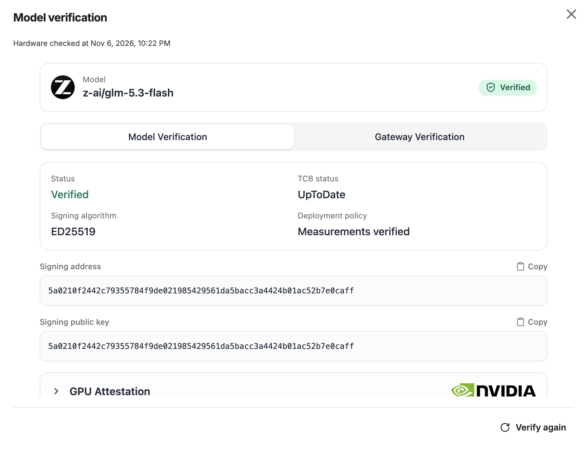

Add the [Verification Center](/cloud/verification/verification-center) with an HTML `<iframe>` and plain JavaScript. Your application supplies verification reports; the viewer displays them through `postMessage`.

<Note>
  This page covers iframe communication. Your application runs verification and prepares reports in the [format below](#report-types). The viewer validates their structure without independently verifying their evidence.
</Note>

<Frame caption="Example model verification view with Model and Gateway tabs, attestation details, and a Verify again action.">
  
</Frame>

## 1. Add the iframe

Serve your application over HTTPS. Register the message listener before setting the iframe’s `src`.

```html
<iframe
  id="verification"
  title="NEAR AI Verification Center"
  allow="clipboard-write"
  referrerpolicy="no-referrer"
  style="width: 100%; max-width: 720px; height: 80vh; border: 0"
></iframe>
```

## 2. Connect the viewer

Save this as `verification.js`. The connection code uses browser APIs and has no SDK or framework dependency.

```js verification.js
export function showVerification(getReports) {
  const iframe = document.getElementById('verification');
  const viewer = new URL('https://cloud.near.ai/verify?canRequestReports=true');
  let requestId = '';

  async function receive(event) {
    if (
      event.origin !== viewer.origin ||
      event.source !== iframe.contentWindow
    ) return;

    const { type, version, requestId: id } = event.data ?? {};
    if (version !== 1 || typeof id !== 'string' || !id) return;
    if (![
      'NEAR_AI_VERIFICATION_CENTER_READY',
      'NEAR_AI_REQUEST_VERIFICATION_REPORT',
    ].includes(type)) return;

    requestId = id;
    let reports;
    try {
      reports = await getReports();
    } catch {
      console.error('The application could not prepare verification reports.');
      return;
    }
    if (requestId !== id) return;
    iframe.contentWindow?.postMessage(
      {
        type: 'NEAR_AI_VERIFICATION_REPORT',
        version: 1,
        requestId: id,
        reports,
      },
      viewer.origin,
    );
  }

  window.addEventListener('message', receive);
  iframe.src = viewer.href;

  return () => {
    requestId = '';
    window.removeEventListener('message', receive);
    iframe.removeAttribute('src');
  };
}
```

## 3. Supply your reports

Supply a callback that returns [`VerificationReport`](#report-types) objects for your model, Gateway, or response, including unsuccessful verification results:

```ts
type GetReports = () => Promise<VerificationReport[]>;
```

After the iframe exists, pass your callback from your application module or a `<script type="module">`:

```js
import { showVerification } from './verification.js';

// reports is your application's prepared VerificationReport[].
const disconnect = showVerification(async () => reports);
```

This example reuses your application's prepared reports. The connection calls the callback when the viewer is ready and whenever the user selects **Verify again**. To provide fresh results, run verification or retrieve updated reports from your application's verification service inside the callback.

Call `disconnect()` before removing the iframe or changing the verification target, then reconnect with the callback for the new target. Pending results from the previous connection are ignored.

### Report types

Choose the report type for what your application verifies. Both use the shared types below. These declarations describe the payload; the JavaScript connection does not import them.

```ts
type VerificationReport = ResponseReport | AttestationReport;
```

<Tabs>
<Tab title="Model / Gateway" id="attestation-report">

Use this type for deployment attestation. Both model and Gateway reports use `kind: 'model'`; `scope` distinguishes them. The `model` field identifies the target model and is required for this report type, including Gateway-only reports.

```ts
type AttestationReport = {
  schemaVersion: 1;
  kind: 'model';
  model: string;
  scope: 'model' | 'gateway' | 'unknown';
  status: 'verified' | 'partial' | 'failed' | 'unverifiable';
  attestation?: AttestationSummary;
  error?: { code?: string; message: string };
};
```

</Tab>
<Tab title="Response" id="response-report">

Use this type for a specific response. Its protocol value is `kind: 'response'`.

```ts
type ResponseReport = {
  schemaVersion: 1;
  kind: 'response';
  completionId: string;
  model?: string;
  scope: 'model' | 'gateway' | 'unknown';
  status: 'verified' | 'partial' | 'failed' | 'unverifiable';
  signature?: CompletionSignature;
  attestation?: AttestationSummary;
  error?: { code?: string; message: string };
};
```

Successful response reports require both `signature` and `attestation`, with matching signing identities. Model scope requires a `provider_tee` signature; Gateway scope requires a `gateway` signature.

The viewer derives a model-signed response's model from its signed payload; any supplied `model` must match. Successful Gateway-only results appear as **Gateway verified** in the viewer; they do not attest model execution.

</Tab>
</Tabs>

<Accordion title="Shared signature and attestation types">

```ts
import type {
  CompletionSignature, GatewayTlsBinding, RuntimeMeasurements, SigningIdentity,
} from '@nearai/inference-sdk';

type AttestationSummary = {
  signer: SigningIdentity;
  tcbStatus:
    | 'UpToDate' | 'SWHardeningNeeded' | 'ConfigurationNeeded'
    | 'ConfigurationAndSWHardeningNeeded' | 'OutOfDate'
    | 'OutOfDateConfigurationNeeded' | 'Revoked' | 'Unknown';
  advisoryIds: string[];
  deploymentProvenance: 'verified' | 'not_checked';
  deployment: { runtimeMeasurements: RuntimeMeasurements };
  gpuEvidence?: 'verified' | 'not_provided';
  signingPublicKey?: string;
  tlsBinding?: GatewayTlsBinding;
};
```

</Accordion>

- Successful reports require `attestation`, a known `scope`, and no `error`. Model scope requires `gpuEvidence`; Gateway scope requires `tlsBinding` and `status: "partial"`. Only model scope can use `status: "verified"`.
- Use `failed` when verification rejects a signature or evidence, and `unverifiable` when it cannot complete. Include a safe `error.message`; use `scope: "unknown"` if verification could not establish the scope.

Return a nonempty array with at most 1,000 reports and 1 MiB of projected UTF-8 JSON. All reports must refer to the same model, and all response reports to the same completion.

Select report fields explicitly before sending them. A type annotation or `as VerificationReport` does not remove runtime fields. Keep API keys, chat content, raw SDK results, raw exceptions, and deployment configuration out of reports.

For SDK verification, see the [JavaScript SDK guide](/cloud/inference-sdk/javascript). Convert SDK verification results to this format in your application. For response reports, call `verifyResponse()` on the original SDK client that made the request, after any response stream is fully consumed.

## Customize the viewer

Add these optional parameters to the viewer URL in `verification.js`:

| Parameter | Default | Meaning |
| --- | --- | --- |
| `darkMode` | `false` | Use a dark viewer. |
| `showHeader` | `true` | Set to `false` to hide the page header. |
| `canRequestReports` | `false` | Enable **Verify again**, which calls `getReports` again. |

For example: `https://cloud.near.ai/verify?darkMode=true&showHeader=false&canRequestReports=true`.

## Troubleshooting

| Symptom | What to check |
| --- | --- |
| Blank viewer | Use HTTPS. Allow `https://cloud.near.ai` in CSP `frame-src`. If sandboxed, include `allow-scripts allow-same-origin`. |
| No report received | Ensure `getReports()` resolves with a nonempty report array. Check the browser console for callback errors. |
| Invalid report | Check the versions, required fields, report limits, and matching signer identities. Keep the origin, source, and request-ID checks in the example. |
| SDK cannot find the completion | Reuse the original SDK client and finish consuming the response stream before preparing reports. |

## Reference

- [JavaScript SDK](/cloud/inference-sdk/javascript): create completions and verify responses.
- [Verification Center](/cloud/verification/verification-center): inspect a model or response in the standalone viewer.
- [Verification policy](/cloud/verification/reference/verification-policy): choose the checks your application requires.
