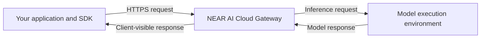

Verification lets your application check evidence about the services handling a request and the identity that signed its response. These checks help you decide whether an environment, connection, and response meet your application's trust requirements.

**Attestation** is hardware-signed evidence about an environment and its keys. **Verification** checks that evidence and its bindings. Your **policy** defines which evidence, deployments, and build sources you accept. For an introduction to the hardware protection, see [Private Inference](/cloud/private-inference).

## Two environments, different evidence

Requests through `cloud-api.near.ai` pass through a Gateway before reaching a model provider. The Gateway and a model's execution environment have separate identities and attestation evidence.

Gateway evidence describes the service receiving your API request. Model evidence, where supported, describes a model-serving environment. Verifying the Gateway alone does not verify the model environment.

## Follow one request

<Steps>
  <Step title="Verify the environment before inference">
    The SDK verifies Gateway attestation and model evidence for supported NEAR models before sending the inference request. It retains the verified signing identities for later response verification and can reuse cached verification results.

    **Automatic in the SDK's default verification flow.** Requirements such as approved deployment measurements and image build sources belong in your [verification policy](/cloud/verification/reference/verification-policy).
  </Step>
  <Step title="Bind the connection and send the request">
    TLS binding compares the actual HTTPS peer with the identity bound into the Gateway's attestation. This requires access to the peer certificate; a browser cannot perform this check through ordinary browser networking APIs.

    **Runtime-dependent.** See [TLS connection binding](/cloud/verification/cloud-api/tls) for supported client behavior. Optional [E2EE](/cloud/guides/e2ee-chat-completions) and [OHTTP](/cloud/inference-sdk#ohttp) provide additional encryption with different endpoints.
  </Step>
  <Step title="Verify the response after receiving it">
    Call `verifyResponse()` or your language's equivalent on the same SDK client, using the response ID. The SDK checks the receipt signature, its signer, and the hashes of the request and response bytes it retained.

    **Explicit application call.** For streaming, consume the complete stream first. A successful inference call does not mean that response verification has run.
  </Step>
  <Step title="Decide whether the result meets your requirements">
    Inspect the verified receipt's signature kind: `provider_tee` identifies a model-side signer; `gateway` identifies the Gateway signer. If your application requires a model-side signature, a Gateway signature does not satisfy that requirement.

    **Application policy.** Use the answer only after the checks your application requires have passed.
  </Step>
</Steps>

## What each check establishes

| Your question | Check | Meaning of a successful check |
| --- | --- | --- |
| What environment and signing identity am I trusting? | [Gateway](/cloud/verification/cloud-api/gateway-attestation) and [model attestation](/cloud/verification/cloud-api/model-attestations) | The hardware evidence and the identity it binds passed verification. Approving the measured deployment is a separate policy decision. |
| Does my HTTPS connection reach the attested identity? | [TLS connection binding](/cloud/verification/cloud-api/tls) | The live connection's peer public key matches the verified Gateway evidence. |
| Do the software images come from an accepted build source? | [Image provenance](/cloud/verification/cloud-api/image-provenance) | The selected image digests satisfy the configured source and build policy. This does not by itself verify model weights or prove which weights handled a request. |
| Were these exact request and response bytes signed by a verified identity? | [Response signatures](/cloud/verification/cloud-api/response-signatures) | The receipt matches the retained bytes and the corresponding verified signer. Its signature kind determines whether that signer is the Gateway or model side. |

These checks establish different properties. A valid hardware quote, an approved image build, and a verified response receipt are not interchangeable results.

## Start verifying

<CardGroup cols={2}>
  <Card title="Verify a response with the SDK" icon="code" href="/cloud/verification/verify-with-sdk">
    Recommended for applications. Send a request, verify its receipt, and interpret the result in JavaScript, Python, Rust, or Go.
  </Card>
  <Card title="Inspect evidence in your browser" icon="search-check" href="/cloud/verification/verification-center">
    Use the Verification Center to inspect hardware evidence and a supplied reply receipt without writing code.
  </Card>
</CardGroup>

The browser tool is useful for inspection; it does not replace the checks enforced by your own application. If a result is unavailable or a check fails, use [Troubleshooting](/cloud/verification/troubleshooting) to identify the stage and next action.

## Go deeper

To implement or audit the protocol, start with [Gateway attestation](/cloud/verification/cloud-api/gateway-attestation). The **How verification works** pages explain each check; **Protocol reference** contains the quote bindings and manual signature helpers.

This section follows the Gateway request path. Model evidence depends on provider and model support; other models may have Gateway-only verification. Direct model endpoints (`{slug}.completions.near.ai`) have an experimental [Direct Completions](/cloud/experimental/direct-completions) workflow.
