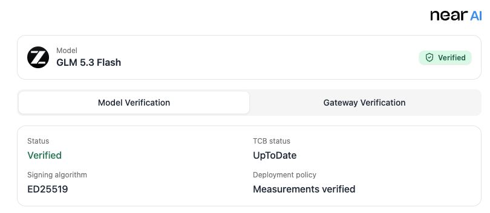

The Verification Center checks hardware evidence and signing identities in your browser. You can use it without an API key.

## Open the page

- **Check a deployment.** [Open GLM-5.3 Flash in the Verification Center](https://cloud.near.ai/verify?model=z-ai%2Fglm-5.3-flash). The page fetches fresh evidence as soon as it opens. For another model, replace the `model` parameter with its URL-encoded ID.
- **Check a specific reply.** Open the verification link supplied by the application that sent the request. It includes a [reply receipt](#verify-a-reply) so the page can check the signature against fresh evidence.

## How verification works

The page uses the NEAR AI inference SDK to check evidence for the following services:

| Evidence | What it covers |
| --- | --- |
| **Gateway** | The NEAR AI Cloud gateway that receives requests. See [Gateway attestation](/cloud/verification/cloud-api/gateway-attestation). |
| **Model** | The Trusted Execution Environment (TEE) that runs the model, including its GPUs. See [Model attestations](/cloud/verification/cloud-api/model-attestations). |

Model evidence is checked only for models whose attestation format the SDK supports. For other models the page verifies the Gateway and tells you that model verification is not yet supported.

## Read the overall result

For a model link, look at the badge beside the model name. With a reply link, also check the **Response** card above the hardware evidence.



| What you see | Meaning |
| --- | --- |
| **Verified** beside the model name | The model and Gateway hardware evidence passed verification. |
| **Verified** on the **Response** card | The receipt signature is valid and its signer matches verified evidence. **Signature scope** identifies the signer as **Model TEE** or **Cloud gateway**. |
| **Gateway verified** | The hardware evidence covers only the Gateway. With a verified Gateway receipt, the **Response** card also identifies the Gateway as the signer. |
| **Response partially verified** | The Gateway signed the receipt. Open **Technical details** to see whether the signed text also identifies the model. |
| **Unable to verify** | The page could not retrieve the evidence it needed or match the signer. See [Troubleshooting](#troubleshooting). |
| **Verification needs attention** | A check failed or the verification link is invalid. Read the error for the affected check. |

The Verification Center checks deployment measurements for consistency. To require particular software releases or build sources in your application, configure a [measurement and provenance policy](/cloud/verification/reference/verification-policy).

## Hardware verification

When both services were checked, use the **Model Verification** and **Gateway Verification** tabs to inspect each one. For a Gateway-only result, the page shows the Gateway evidence directly.

### Summary

| Field | Description |
| --- | --- |
| **Status** | `Verified` when the evidence passed verification. |
| **TCB status** | The Intel trusted computing base status reported for the platform, for example `UpToDate`. |
| **Signing algorithm** | The algorithm of the key that signs replies from this component, `ED25519` or `ECDSA`. |
| **Deployment policy** | `Measurements verified` for measurement consistency checks. `Verified` when deployment provenance was also verified. |

### Signing identity

**Signing address** and **Signing public key** identify the key that this component uses to sign replies. These values are bound to the hardware quote, so a verified quote ties the key to the attested environment. Use them to match the signer of a [response signature](/cloud/verification/cloud-api/response-signatures).

### Evidence sections

Expand a section to inspect and copy the evidence behind the result.

<AccordionGroup>
  <Accordion title="TDX Attestation (Intel)">
    The Intel TDX quote and the values it commits to: request nonce, report data, event log, OS image hash, compose hash, app compose, and any Intel security advisories. Links open Intel's TDX documentation and the [Intel TDX Explorer](https://proof.t16z.com/), where you can check the quote independently. See [Quote, nonce, and signer bindings](/cloud/verification/reference/quote-nonce-signer) for how these values are checked.
  </Accordion>
  <Accordion title="GPU Attestation (NVIDIA)">
    When the model supplies GPU evidence, NVIDIA's Remote Attestation Service verifies it and your browser checks the signed result against NVIDIA's public keys. The section lists the nonce, GPU architecture, evidence list, and raw payload.
  </Accordion>
</AccordionGroup>

## Verify a reply

An application that uses NEAR AI can link to the Verification Center with a **reply receipt**, so that you can check one specific response in addition to the hardware evidence. The receipt travels in the URL fragment:

```text
https://cloud.near.ai/verify?model=<MODEL_ID>#receipt=<BASE64URL_JSON>
```

The fragment is base64url-encoded JSON with these fields:

| Field | Required | Description |
| --- | --- | --- |
| `completionId` | Yes | The completion the signature belongs to. |
| `model` | Yes | The model ID. Used when the `model` query parameter is absent. |
| `signatureKind` | Yes | `provider_tee` for a model signature, or `gateway` for a Gateway signature. |
| `signingAlgo` | Yes | `ecdsa` or `ed25519`. |
| `signingAddress` | Yes | The signer's address (ECDSA) or public key (Ed25519). |
| `signedText` | Yes | The exact text that was signed. |
| `signature` | Yes | The signature over `signedText`. |
| `verifiedAt` | No | When the linking application verified the receipt. |

With a receipt, the **Response** card shows three checks under **Technical details**:

1. **Signature**: your browser checks the signature over `signedText`. ECDSA signatures must be 65 bytes and recover the stated address. Ed25519 signatures are checked against the stated 32-byte public key.
2. **Model binding**: the signed text must name the same model as the receipt and the verified deployment. A Gateway receipt whose signed text does not include a model can be only partially verified.
3. **Signer**: the signing key must match a signer in the freshly verified evidence. A `provider_tee` signature must come from one of the verified model replicas, and a `gateway` signature must come from the verified Gateway.

For a verified receipt, the card shows the completion ID, signing address, signed message, and signature. Open **Technical details** to see the request and response hashes (SHA-256).

<Note>
  The page verifies the signature over the receipt's hashes. Use the SDK in the application that sent the request to compare those hashes with the original request and response bytes; see [response signatures](/cloud/verification/cloud-api/response-signatures).
</Note>

If the signer cannot be matched, its key may have rotated since the reply. Verify with the original SDK client, which retains the request's verification context.

## Privacy

- The receipt is read from the URL fragment (`#`), which browsers do not send in page requests.
- The page does not send the receipt to analytics.
- Verification requests do not include chat content.

## Troubleshooting

| Message | What to do |
| --- | --- |
| *Model or attestation evidence was not found (HTTP 404)* | Check the model ID in the link, including URL encoding. |
| *The verification request was rejected (HTTP 400)* | Check the model ID and the link. |
| *The verification service is rate limited (HTTP 429)* | Wait and select **Verify Again**. |
| *The response receipt is invalid* | Open a new verification link from the application that sent the request. |
| *Hardware evidence is unavailable* | Evidence could not be retrieved. Try again later. |
| *This model does not expose an attestation format supported by this SDK* | Only the Gateway can be verified for this model. |
| *Hardware evidence failed verification* | The evidence did not pass a check. Treat the model property as unverified. |

## Next steps

Use [Verify with the SDK](/cloud/verification/verify-with-sdk) to verify the exact bytes of your application's request and response. For errors, see [troubleshooting](/cloud/verification/troubleshooting); for the relationship between environment evidence, deployment policy, and reply signatures, return to the [verification overview](/cloud/verification).
